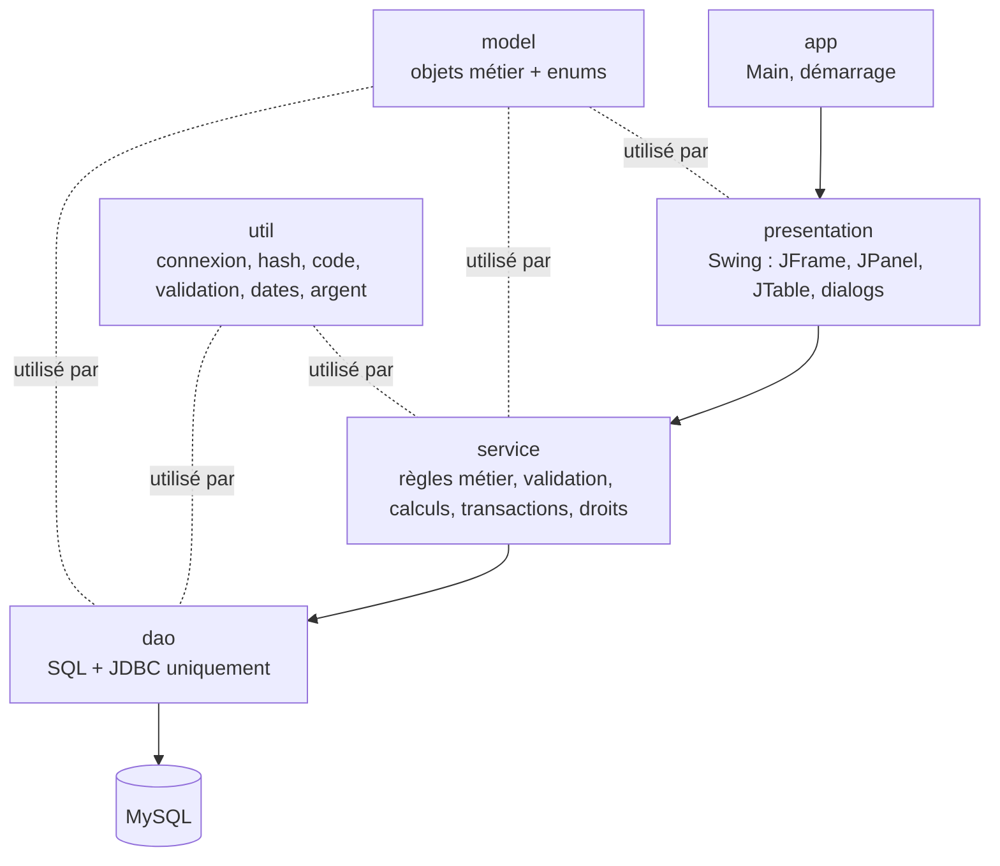
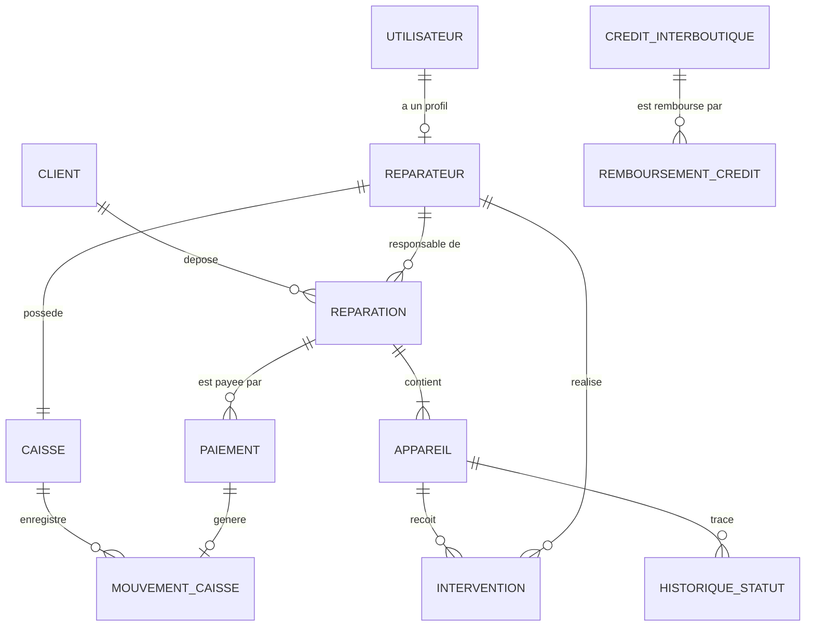
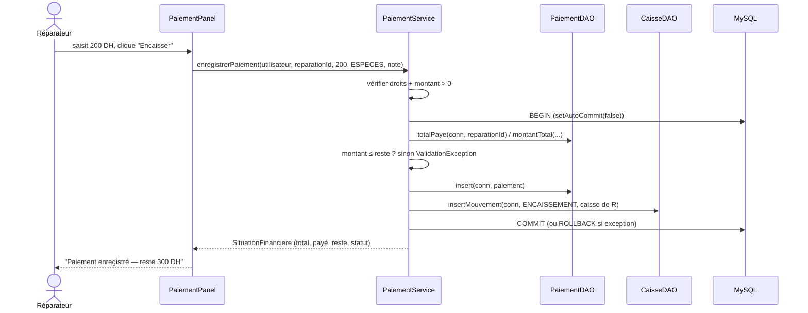

# Architecture — RepairTrack

> Version 0.1 — 14/10/2026. Toute modification de ce document passe par le chef de projet (M1).

## 1. Choix techniques

| Élément | Choix | Raison |
|---------|-------|--------|
| Java | **17 (LTS)** | Records/switch modernes disponibles, installé partout, supporté par tous les IDE |
| Build | **Projet Eclipse** (sans Maven — imposé) | Configuration partagée : `.project`, `.classpath`, `.settings/` (Java 17, UTF-8), lancements `.launch` |
| UI | Swing | Imposé |
| BD | MySQL 8 | Imposé ; supporte les `CHECK` (8.0.16+) |
| Accès BD | JDBC + `mysql-connector-j` | Imposé, seule dépendance runtime |
| Tests | JUnit 5 (scope `test`) | Seule dépendance de test |
| Look & feel | Celui du système + `UiTheme.BoutonPlat` (boutons dessinés) | Couleurs identiques sous Windows, macOS, Linux |
| Hash mot de passe | PBKDF2WithHmacSHA256 (inclus dans le JDK) | Pas de bibliothèque externe |
| Config BD | Fichier `db.properties` (hors Git) + `db.properties.example` (dans Git) | Simple à comprendre, aucun mot de passe dans le code |

**Bibliothèques au total : 2** — `lib/mysql-connector-j.jar` (déposé dans le projet) et JUnit 5 (fourni par Eclipse, conteneur `JUNIT_CONTAINER/5`). Toute nouvelle bibliothèque doit être approuvée par M1.

## 2. Couches



### Règles de dépendance (vérifiées en revue de code)

| Package | Peut utiliser | Ne doit **jamais** utiliser |
|---------|---------------|-----------------------------|
| `presentation` | service, model, util (formatage) | dao, `java.sql` |
| `service` | dao, model, util | `javax.swing`, `java.awt` |
| `dao` | model, util | service, presentation |
| `model` | (rien d'autre que le JDK) | `java.sql`, dao, service |
| `util` | JDK | les autres packages (sauf model pour `MoneyUtil` si besoin) |
| `app` | tout | — |

## 3. Structure des packages

```
repairtrack/
├── .project, .classpath, .settings/   # projet Eclipse
├── RepairTrack.launch, Tests RepairTrack.launch
├── lib/mysql-connector-j.jar
├── README.md, TODO.md, CHANGELOG.md
├── db.properties.example          # copié en db.properties (ignoré par Git)
├── database/
│   ├── schema.sql
│   └── data.sql
├── docs/
└── src/
    ├── main/java/ma/phonerepair/
    │   ├── app/
    │   │   ├── Main.java                 # point d'entrée : SwingUtilities.invokeLater(...)
    │   │   └── Application.java          # look & feel, test connexion BD, ouverture LoginFrame
    │   ├── model/
    │   │   ├── Boutique, Utilisateur, Reparateur, Client, Reparation, Appareil,
    │   │   ├── Intervention, HistoriqueStatut, Paiement, Caisse, MouvementCaisse,
    │   │   ├── Credit, RemboursementCredit, SituationFinanciere, ResumeReparation, SuiviClient,
    │   │   ├── DossierPaiement, ResumeCaisse, Statistiques, PerformanceReparateur
    │   │   └── enums/
    │   │       ├── Role, StatutReparation, StatutGlobal, StatutPaiement, Periode,
    │   │       └── TypePaiement, TypeMouvement, SensCredit, StatutCredit
    │   ├── dao/
    │   │   ├── BoutiqueDAO, UtilisateurDAO, ReparateurDAO, ClientDAO, ReparationDAO,
    │   │   ├── AppareilDAO, InterventionDAO, HistoriqueStatutDAO, PaiementDAO,
    │   │   ├── CaisseDAO, CreditDAO, StatistiqueDAO
    │   │   ├── HistoriqueStatutDAO.java
    │   │   ├── TransactionManager.java  # commit / rollback centralisé
    │   │   ├── DaoUtil.java             # id généré, petites aides JDBC
    │   │   └── DataAccessException.java
    │   ├── service/
    │   │   ├── AuthService, BoutiqueService, ReparateurService, ClientService,
    │   │   ├── ReparationService, AppareilService, PaiementService, CommissionService,
    │   │   ├── CaisseService, CreditService, StatistiqueService, SuiviService
    │   │   ├── ReparateurService, Autorisation, SuiviService
    │   │   └── exception/
    │   │       ├── BusinessException.java       # règle métier violée
    │   │       ├── ValidationException.java     # saisie invalide (extends BusinessException)
    │   │       └── AccesRefuseException.java    # droit insuffisant
    │   ├── presentation/
    │   │   ├── LoginFrame, DashboardFrame, AccueilPanel, UiTheme (couleurs, polices), UiUtil (messages),
    │   │   ├── CarteChiffre, MouvementsTableModel
    │   │   ├── proprietaire/  BoutiquePanel, ReparateursPanel, CaissesPanel,
    │   │   │                  StatistiquesPanel, CreditsPanel
    │   │   ├── reparateur/    NouvelleReparationPanel, AppareilForm, MesReparationsPanel,
    │   │   │                  DetailReparationDialog, InterventionDialog,
    │   │   │                  PaiementPanel, MaCaissePanel
    │   │   └── client/        SuiviReparationPanel
    │   └── util/
    │       ├── DatabaseConfig.java      # lit db.properties
    │       ├── DatabaseConnection.java  # DriverManager.getConnection(...)
    │       ├── PasswordUtil, CodeGenerator, ValidationUtil, DateUtil, MoneyUtil
    └── test/java/ma/phonerepair/
        ├── service/   CommissionServiceTest, PaiementCalculTest, StatutGlobalTest, ...
        └── util/      CodeGeneratorTest, ValidationUtilTest, PasswordUtilTest
```

### Écarts avec la structure cible du sujet (justifiés)

| Écart | Raison |
|-------|--------|
| `DatabaseConnection` dans `util/` au lieu de `app/` | Les DAO en ont besoin. S'il était dans `app/`, `dao` dépendrait de `app` (dépendance inversée). Le sujet place déjà la config BD dans `util`. |
| `database/` à la racine du projet, pas dans `ma/phonerepair` | Ce sont des scripts SQL, pas du Java. |
| Ajout de `HistoriqueStatut`, `MouvementCaisse`, `RemboursementCredit` (model + DAO) | Tables exigées par le sujet. |
| Ajout de `ReparateurService`, `SuiviService`, `HistoriqueStatutDAO` | Évite de surcharger `AuthService` / `ReparationService`. |
| Sous-packages `service/exception`, `model/enums` | Les 6 packages principaux restent inchangés. |
| Pas d'interfaces DAO | Une seule implémentation (MySQL) → une interface n'apporte rien ici. |

## 4. Modèle de données (résumé — détail dans `database.md`)



| Table | Colonnes principales | Contraintes clés |
|-------|----------------------|------------------|
| `boutique` | id, nom, adresse, telephone, numero_patente | une seule ligne (`CHECK id = 1`) |
| `utilisateur` | id, nom_complet, telephone, username, password_hash, role, actif, date_creation | username UNIQUE, role CHECK IN |
| `reparateur` | id, utilisateur_id, taux_commission | utilisateur_id UNIQUE, CHECK 0 ≤ taux ≤ 100 |
| `client` | id, nom_complet, telephone, date_creation | INDEX telephone |
| `reparation` | id, code_suivi, client_id, reparateur_id, cree_par, date_creation, remarque | **code_suivi UNIQUE** |
| `appareil` | id, reparation_id, marque, modele, imei_serie, description, etat_physique, probleme_signale, statut, date_maj_statut | statut ENUM |
| `intervention` | id, appareil_id, reparateur_id, diagnostic, pieces_description, cout_achat_pieces, prix_pieces_client, main_oeuvre, **taux_commission_applique**, date_intervention | montants DECIMAL(10,2) CHECK ≥ 0 |
| `historique_statut` | id, appareil_id, ancien_statut, nouveau_statut, date_changement, utilisateur_id, commentaire | ancien NULL à la création |
| `paiement` | id, reparation_id, montant, date_paiement, type_paiement, utilisateur_id, note | CHECK montant > 0 |
| `caisse` | id, reparateur_id, date_creation | reparateur_id UNIQUE |
| `mouvement_caisse` | id, caisse_id, type, montant, date_mouvement, paiement_id, utilisateur_id, libelle | CHECK montant > 0, paiement_id UNIQUE NULL |
| `credit_interboutique` | id, sens, nom_boutique_tiers, proprietaire_tiers, patente_tiers, telephone_tiers, montant, date_credit, description, cree_par | CHECK montant > 0 |
| `remboursement_credit` | id, credit_id, montant, date_remboursement, note, utilisateur_id | CHECK montant > 0 |

**Volontairement non stockés** (calculés) : statut global de réparation, total / payé / reste, statut de paiement, solde de caisse, commission (montant), reste dû d'un crédit. → une seule source de vérité, pas d'incohérence possible.

## 5. Flux type : enregistrer un paiement



## 6. Transactions

Règle : **le service décide de ce qui forme une transaction**, les DAO reçoivent la `Connection` en paramètre et déclarent `throws SQLException`. Le commit / rollback est centralisé dans `dao/TransactionManager` pour ne pas recopier le même bloc dans chaque service.

```java
// Dans un service — écriture atomique (ex. ReparateurService.creerReparateur)
return TransactionManager.enTransaction(conn -> {
    int utilisateurId = utilisateurDAO.inserer(conn, u);
    int reparateurId = reparateurDAO.inserer(conn, utilisateurId, taux);
    caisseDAO.creer(conn, reparateurId);
    return utilisateurId;          // commit si tout passe, rollback sinon
});

// Lecture simple
List<Utilisateur> comptes = TransactionManager.lecture(utilisateurDAO::listerTous);
```

`TransactionManager` traduit toute `SQLException` en `DataAccessException` (et la journalise). Le service peut tester `e.concerne("uq_utilisateur_username")` pour transformer une violation de contrainte en message clair.

Opérations transactionnelles obligatoires : créer un réparateur (utilisateur + reparateur + caisse) ✅, activer le profil réparateur du propriétaire (reparateur + caisse) ✅, créer une réparation (réparation + appareils + historique), changer un statut (appareil + historique), enregistrer un paiement (paiement + mouvement) ✅, mouvement manuel de caisse (contrôle du solde + insert, caisse verrouillée) ✅, enregistrer un remboursement de crédit (vérif reste + insert).

## 7. Gestion des erreurs

| Exception | Lancée par | Message affiché | Log |
|-----------|-----------|-----------------|-----|
| `ValidationException` | service | message exact (« Le montant doit être positif ») | non |
| `BusinessException` | service | message exact (« Transition non autorisée… ») | non |
| `AccesRefuseException` | service | « Action réservée au propriétaire » | oui (WARNING) |
| `DataAccessException` | `TransactionManager` (enveloppe `SQLException`) | « Erreur technique, réessayez ou contactez l'administrateur » | oui (SEVERE, avec la `SQLException`) |

- Les DAO ne renvoient **jamais** une `SQLException` brute à l'UI.
- Violation de contrainte UNIQUE (ex. username) : le DAO détecte `SQLIntegrityConstraintViolationException` → le service la traduit en message clair.
- Logging : `java.util.logging` (JDK), fichier `logs/repairtrack.log` (configuré dans `Application`). Pas de `System.out.println` comme gestion d'erreurs.
- Dans l'UI, un seul helper : `UiUtil.executer(composant, () -> service.xxx(...))` qui attrape les exceptions, affiche le bon `JOptionPane` et renvoie `true` si tout s'est bien passé.

## 8. Authentification et droits

- `AuthService.login(username, motDePasse)` renvoie un `Utilisateur` (avec son profil réparateur s'il existe).
- Cet objet est passé au `DashboardFrame`, puis à chaque panel, puis en **premier paramètre** des méthodes de service sensibles (`acteur`). Pas de variable statique globale.
- Chaque méthode de service sensible commence par une vérification : `Autorisation.exigerProprietaire(acteur)` ou `Autorisation.exigerProfilReparateur(acteur)` (classe `service/Autorisation`).

## 9. Swing

- Navigation : `DashboardFrame` = menu latéral + zone centrale en `CardLayout`.
- Les accès BD longs (statistiques) passent par `SwingWorker` pour ne pas figer l'interface (SHOULD).
- `UiTheme` centralise couleurs et polices → identité visuelle cohérente.
- Aucune requête SQL ni calcul métier dans un `ActionListener` : un listener lit les champs, appelle **un** service, affiche le résultat.

## 10. Convention de nommage

- Code (classes, méthodes, tables) en **français**, sans accents (`Reparation`, `montantTotal`).
- Constantes d'enum de statut : celles du sujet (`RECEIVED`, `PAID`…), avec un `libelle` français affiché dans l'UI.
- Tables et colonnes en `snake_case`.
