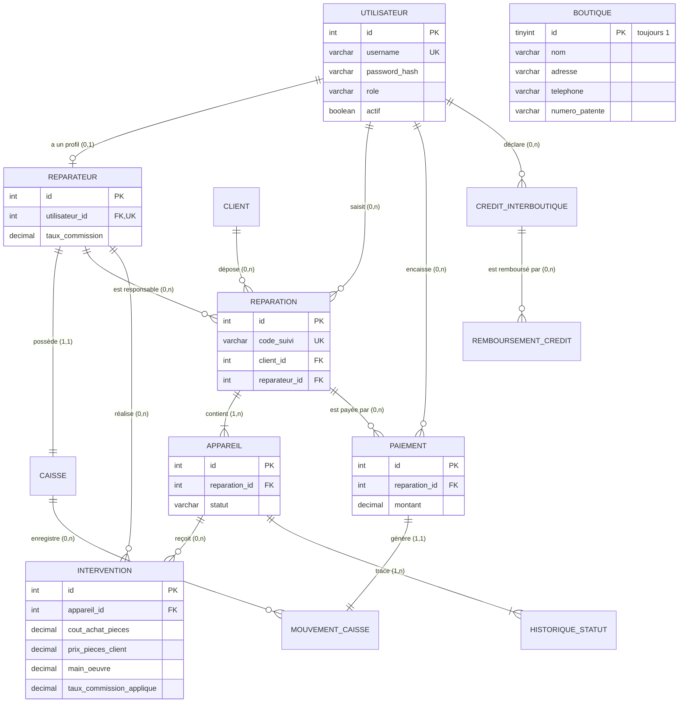

# Conception de la base de données — RepairTrack

> Version 1.0 — 14/10/2026 — scripts : `database/schema.sql`, `database/data.sql`.
> SGBD cible : **MySQL 8.0.16+** (nécessaire pour que les `CHECK` soient appliqués). Moteur InnoDB, `utf8mb4`.

## 1. MCD (entités et associations)



`BOUTIQUE` est isolée : l'application est mono-boutique, une seule ligne existe (contrainte `CHECK (id = 1)`), donc aucune clé étrangère n'est nécessaire vers elle.

## 2. Cardinalités

| Association | Cardinalité | Règle |
|-------------|-------------|-------|
| Utilisateur — Réparateur | 1 — 0..1 | RG-02 : le propriétaire peut avoir un profil réparateur |
| Réparateur — Caisse | 1 — 1 | une caisse par réparateur |
| Client — Réparation | 1 — 0..n | |
| Réparation — Appareil | 1 — 1..n | RG-10 (le « au moins 1 » est vérifié par le service) |
| Appareil — Intervention | 1 — 0..n | en pratique 1, 2 en cas de reprise |
| Appareil — Historique | 1 — 1..n | une ligne dès la création (`ancien_statut` NULL) |
| Réparation — Paiement | 1 — 0..n | RG-25 : paiements multiples, au niveau de la réparation |
| Paiement — Mouvement caisse | 1 — 1 | RG-30, garanti par `UNIQUE(paiement_id)` + CHECK |
| Caisse — Mouvement | 1 — 0..n | |
| Crédit — Remboursement | 1 — 0..n | RG-42 |

## 3. MLD

- **boutique** (<u>id</u>, nom, adresse, telephone, numero_patente, date_creation)
- **utilisateur** (<u>id</u>, nom_complet, telephone, username, password_hash, role, actif, date_creation)
- **reparateur** (<u>id</u>, #utilisateur_id, taux_commission)
- **caisse** (<u>id</u>, #reparateur_id, date_creation)
- **client** (<u>id</u>, nom_complet, telephone, date_creation)
- **reparation** (<u>id</u>, code_suivi, #client_id, #reparateur_id, #cree_par, date_creation, remarque)
- **appareil** (<u>id</u>, #reparation_id, marque, modele, imei_serie, description, etat_physique, probleme_signale, statut, date_maj_statut)
- **intervention** (<u>id</u>, #appareil_id, #reparateur_id, diagnostic, pieces_description, cout_achat_pieces, prix_pieces_client, main_oeuvre, taux_commission_applique, date_intervention)
- **historique_statut** (<u>id</u>, #appareil_id, ancien_statut, nouveau_statut, date_changement, #utilisateur_id, commentaire)
- **paiement** (<u>id</u>, #reparation_id, montant, date_paiement, type_paiement, #utilisateur_id, note)
- **mouvement_caisse** (<u>id</u>, #caisse_id, type, montant, date_mouvement, #paiement_id, #utilisateur_id, libelle)
- **credit_interboutique** (<u>id</u>, sens, nom_boutique_tiers, proprietaire_tiers, patente_tiers, telephone_tiers, montant, date_credit, description, #cree_par, date_creation)
- **remboursement_credit** (<u>id</u>, #credit_id, montant, date_remboursement, note, #utilisateur_id)

## 4. Contraintes

| Table | Contrainte | Type | Rôle |
|-------|-----------|------|------|
| boutique | `ck_boutique_unique` | CHECK id = 1 | une seule boutique |
| utilisateur | `uq_utilisateur_username` | UNIQUE | RG-04 |
| utilisateur | `ck_utilisateur_role` | CHECK IN | PROPRIETAIRE / REPARATEUR |
| reparateur | `uq_reparateur_utilisateur` | UNIQUE | 1 profil max par utilisateur |
| reparateur, intervention | `ck_*_taux` | CHECK 0..100 | RG-31 |
| caisse | `uq_caisse_reparateur` | UNIQUE | 1 caisse par réparateur |
| reparation | `uq_reparation_code` | UNIQUE | RG-12 : code de suivi unique |
| appareil | `ck_appareil_statut` | CHECK IN | 8 statuts |
| intervention | `ck_intervention_montants` | CHECK ≥ 0 | RG-21 |
| paiement | `ck_paiement_montant` | CHECK > 0 | RG-26 |
| paiement | `ck_paiement_type` | CHECK IN | modes de paiement |
| mouvement_caisse | `uq_mouvement_paiement` | UNIQUE | un paiement → un seul mouvement |
| mouvement_caisse | `ck_mouvement_lien_paiement` | CHECK | ENCAISSEMENT ⇔ paiement_id renseigné |
| credit_interboutique | `ck_credit_sens`, `ck_credit_montant` | CHECK | RG-41, RG-42 |
| remboursement_credit | `ck_remboursement_montant` | CHECK > 0 | RG-42 |

Toutes les clés étrangères sont en `RESTRICT` (comportement par défaut) : **on ne supprime jamais** une donnée référencée (historique financier conservé).

**Règles que la base ne peut pas vérifier seule** (vérifiées par les services) : paiement ≤ reste à payer, remboursement ≤ reste dû, solde de caisse ≥ 0, transitions de statut, au moins un appareil par réparation, paiement requis avant livraison.

## 5. Index

| Index | Requête servie |
|-------|----------------|
| `client(telephone)`, `client(nom_complet)` | recherche client (EF-07) |
| `reparation(date_creation)` | statistiques par période, liste filtrée |
| `appareil(statut, date_maj_statut)` | appareils livrés sur une période → commissions acquises |
| `paiement(date_paiement)` | encaissements par période |
| `mouvement_caisse(caisse_id, date_mouvement)` | relevé d'une caisse |
| `credit_interboutique(patente_tiers)` | recherche d'une boutique tierce |

Les clés étrangères sont indexées automatiquement par InnoDB.

## 6. Types de données

| Donnée | Type | Raison |
|--------|------|--------|
| Montants | `DECIMAL(10,2)` | exact (pas d'erreur d'arrondi), jusqu'à 99 999 999,99 DH ; mappé en `BigDecimal` |
| Taux | `DECIMAL(5,2)` | 0,00 à 100,00 |
| Téléphone, patente, IMEI | `VARCHAR` | zéros initiaux, `+212`, tirets |
| Statuts, rôles, types | `VARCHAR` + `CHECK IN (...)` | correspond à `Enum.name()` en Java ; lisible dans les requêtes |
| Dates d'événement | `DATETIME` | heure locale de la boutique |
| Dates de crédit | `DATE` | l'heure n'a pas de sens |
| Mot de passe | `VARCHAR(255)` | hash PBKDF2 `pbkdf2$iter$sel$hash` |

## 7. Décisions importantes

1. **Valeurs calculées non stockées** : total d'une réparation, montant payé, reste, statut de paiement, statut global, solde de caisse, montant de commission, reste dû d'un crédit. Une seule source de vérité → pas de désynchronisation.
2. **Taux de commission copié** dans `intervention.taux_commission_applique` (RG-33) : changer le taux d'un réparateur ne modifie pas l'historique.
3. **Date de livraison** = `appareil.date_maj_statut` quand `statut = 'DELIVERED'` (état final, plus jamais modifié) → pas de colonne supplémentaire. L'historique la contient aussi.
4. **Code de suivi** : prochain numéro = `MAX(code_suivi)` parmi les codes `REP-<année>-%` + 1 (les codes sont complétés par des zéros, l'ordre alphabétique = l'ordre numérique). En cas de création simultanée, la contrainte UNIQUE rejette le doublon et le service réessaie.
5. **Profil réparateur séparé de l'utilisateur** : le propriétaire peut réparer sans avoir deux comptes.
6. **Montants de mouvement toujours positifs** : le sens est porté par le type (`TypeMouvement.getSens()`), ce qui évite les erreurs de signe.
7. **Boutique tierce non modélisée comme table** : elle n'est pas gérée par l'application, ses informations sont recopiées dans le crédit (pas de sur-normalisation).

## 8. Installation

```bash
mysql -u root -p < database/schema.sql   # crée la base (efface l'ancienne !)
mysql -u root -p < database/data.sql     # compte owner / owner123
```

## 9. Tests du schéma (14/10/2026)

Script chargé sans erreur ; contraintes vérifiées manuellement :

| Test | Résultat |
|------|----------|
| 2ᵉ ligne dans `boutique` | refusé (`ck_boutique_unique`) ✅ |
| rôle `ADMIN` | refusé (`ck_utilisateur_role`) ✅ |
| taux 120 % | refusé (`ck_reparateur_taux`) ✅ |
| mouvement `ENCAISSEMENT` sans paiement | refusé (`ck_mouvement_lien_paiement`) ✅ |
| mouvement `ACHAT_PIECES` sans paiement | accepté ✅ |
| username en double | refusé (`uq_utilisateur_username`) ✅ — testé via `ReparateurService` |
