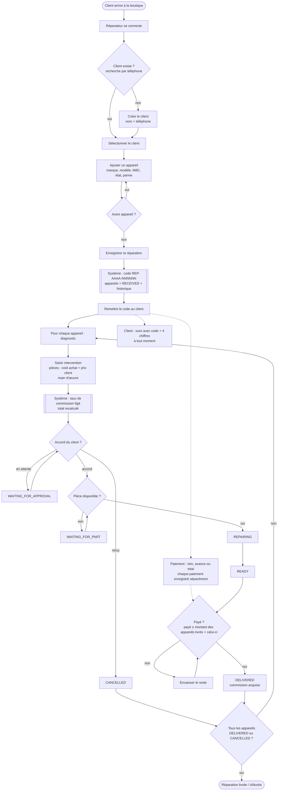

# Diagramme d'activité — cycle d'une réparation

> Règles appliquées : RG-10 à RG-19, RG-26, RG-33, RG-18 (livraison payée).

### Couloirs (qui fait quoi)

| Étape | Client | Réparateur | Système |
|-------|:-:|:-:|:-:|
| Fournir nom + téléphone, déposer les appareils | ✅ | | |
| Rechercher / créer client, saisir les appareils | | ✅ | |
| Générer le code, historiser les statuts | | | ✅ |
| Diagnostic, intervention, changements de statut | | ✅ | |
| Figer le taux, calculer total / reste / statut global | | | ✅ |
| Payer | ✅ | encaisse | contrôle le reste |
| Suivre la réparation | ✅ | | filtre les informations |
