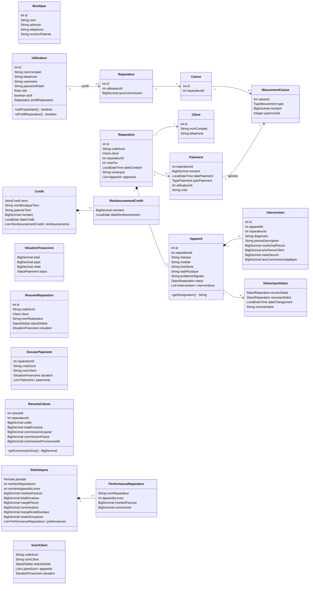
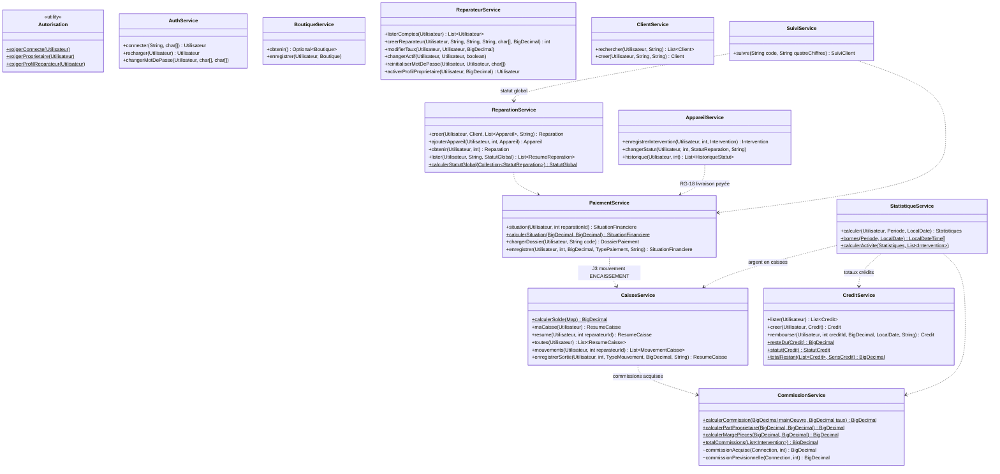
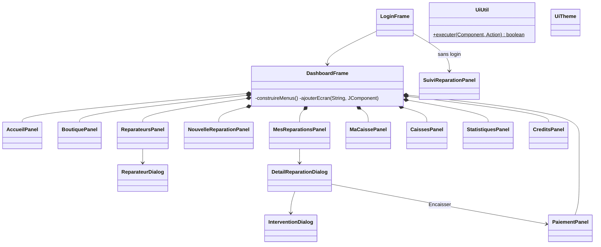

# Diagramme de classes — RepairTrack

> Correspond au code de `src/main/java/ma/phonerepair`. Les getters/setters ne sont pas représentés. Toutes les classes représentées sont implémentées (jalons J1 à J4) — leurs signatures sont un contrat pour l'équipe.

## 1. Modèle (`model`, `model.enums`)

### Enums

```mermaid
classDiagram
    class Role { <<enum>> PROPRIETAIRE; REPARATEUR }
    class StatutReparation {
        <<enum>>
        RECEIVED; DIAGNOSING; WAITING_FOR_APPROVAL; WAITING_FOR_PART
        REPAIRING; READY; DELIVERED; CANCELLED
        +suivantsAutorises() Set
        +peutPasserA(StatutReparation) boolean
        +estFinal() boolean
    }
    class StatutGlobal { <<enum>> RECEIVED; IN_PROGRESS; READY; DELIVERED; CANCELLED }
    class StatutPaiement { <<enum>> UNPAID; PARTIALLY_PAID; PAID }
    class TypePaiement { <<enum>> ESPECES; CARTE; VIREMENT; CHEQUE }
    class TypeMouvement {
        <<enum>>
        ENCAISSEMENT; ACHAT_PIECES; VERSEMENT_PROPRIETAIRE; PAIEMENT_COMMISSION
        +getSens() int
    }
    class SensCredit { <<enum>> ACCORDE; RECU }
    class StatutCredit { <<enum>> EN_COURS; PARTIEL; SOLDE }
    class Periode { <<enum>> JOUR; SEMAINE; MOIS; TOTAL }
```

## 2. Services (`service`)

Tous les services appellent `Autorisation` en début de méthode sensible (non représenté pour la lisibilité).

## 3. Accès aux données (`dao`)

```mermaid
classDiagram
    class TransactionManager {
        <<utility>>
        +enTransaction(Travail~T~)$ T
        +lecture(Travail~T~)$ T
    }
    class DataAccessException {
        +estViolationContrainte() boolean
        +concerne(String) boolean
    }
    class BoutiqueDAO { +trouver(Connection) +inserer(Connection, Boutique) +modifier(Connection, Boutique) }
    class UtilisateurDAO { +trouverParUsername() +trouverParId() +listerTous() +inserer() +modifierActif() +modifierMotDePasse() }
    class ReparateurDAO { +inserer() +modifierTaux() +trouverTaux() }
    class CaisseDAO { +creer() +trouverParReparateur() +listerToutes() +verrouiller() +insererMouvement() +totauxParType() +listerMouvements() }
    class ClientDAO { +rechercher() +inserer() +trouverParId() }
    class ReparationDAO { +prochainNumero() +inserer() +trouverParId() +trouverParCode() +lister() +verrouiller() +montantTotal() }
    class AppareilDAO { +inserer() +listerParReparation() +trouverParId() +modifierStatut() +montantLivreOuALivrer() }
    class InterventionDAO { +inserer() +modifierContenu() +listerParAppareil() +listerParReparation() +listerPourCommission() }
    class HistoriqueStatutDAO { +inserer() +listerParAppareil() }
    class PaiementDAO { +totalPaye() +inserer() +listerParReparation() }
    class CreditDAO { +inserer() +insererRemboursement() +verrouiller() +trouverParId() +listerTous() }
    class StatistiqueDAO { +compterReparations() +compterAppareilsLivres() +interventionsLivrees() +appareilsLivresParReparateur() +totalEncaisse() +resteAEncaisserGlobal() +nomsReparateurs() }
    TransactionManager ..> DataAccessException
```

Chaque méthode DAO reçoit la `Connection` en premier paramètre et déclare `throws SQLException` ; c'est le service qui ouvre la transaction via `TransactionManager`.

## 4. Présentation (`presentation`)

