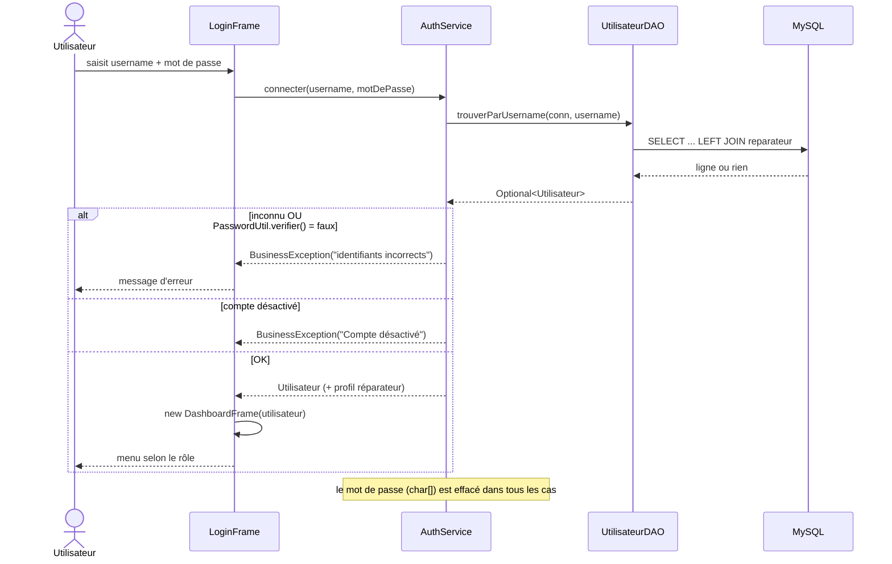
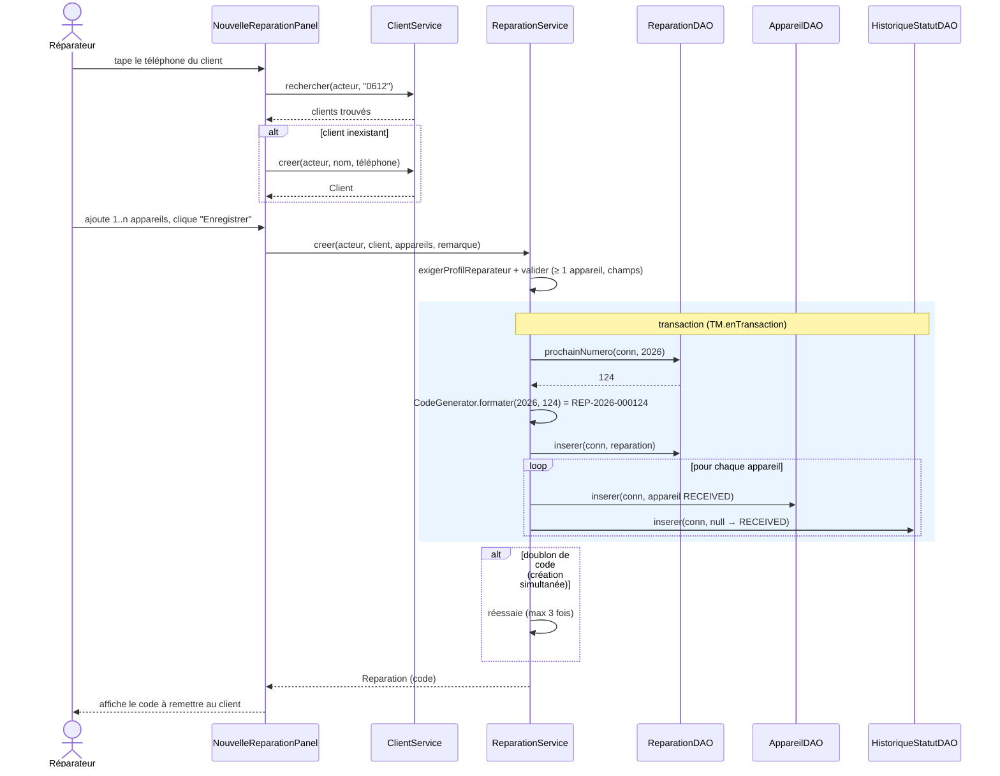
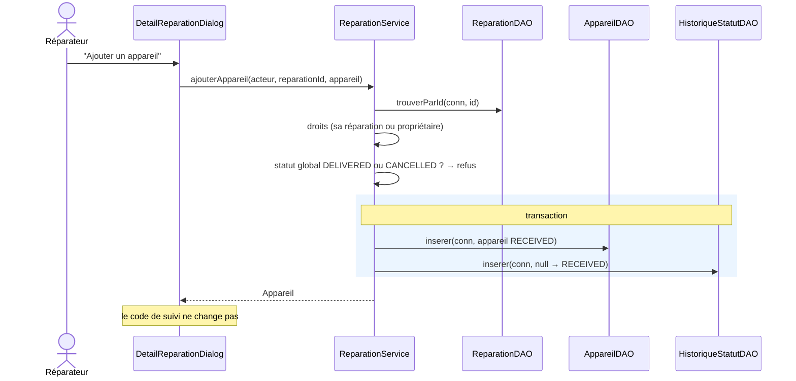
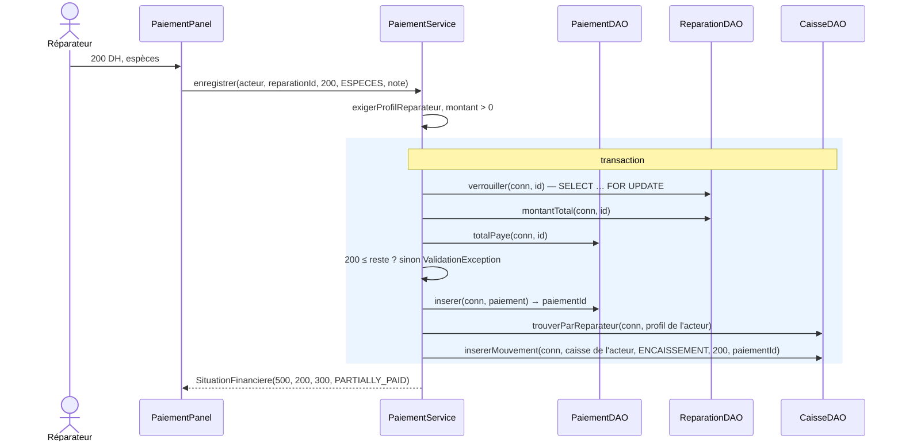
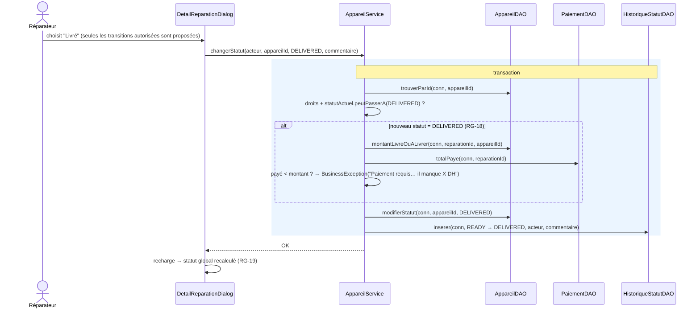
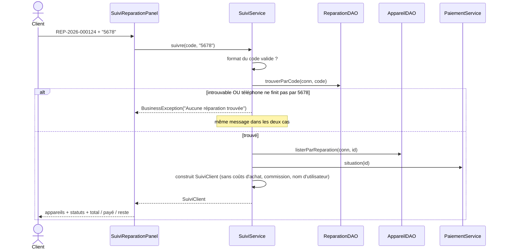
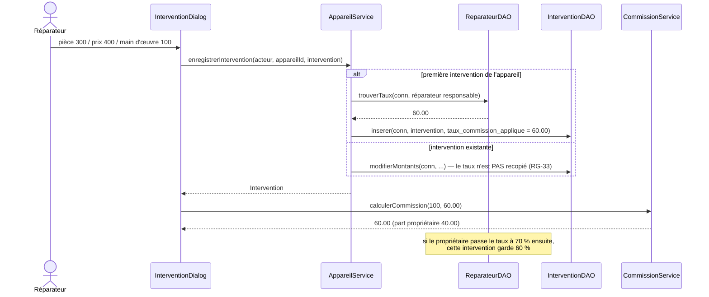
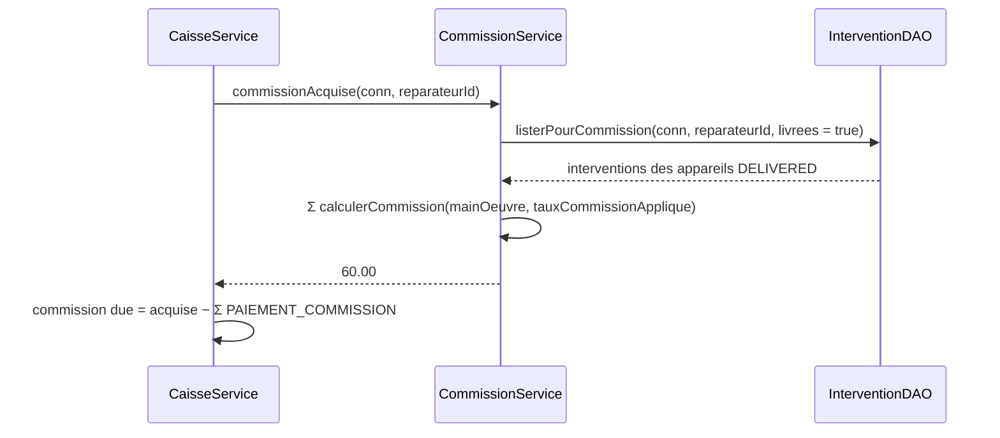
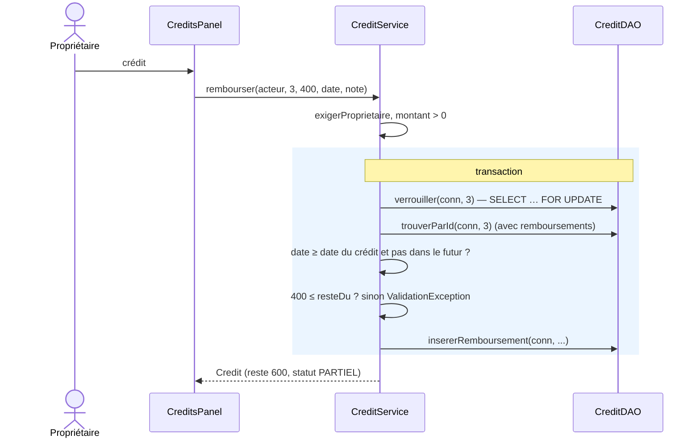

# Diagrammes de séquence — RepairTrack

> Noms de classes et de méthodes = ceux du code (ou du contrat `class-diagram.md` pour J3–J4).
> `TM` = `TransactionManager`. Un bloc « transaction » signifie : tout est validé ensemble, ou rien (rollback).

## 1. Connexion (J1 ✅)

## 2. Créer une réparation (J2 ✅)

## 3. Ajouter un appareil à une réparation existante (J2 ✅)

## 4. Enregistrer un paiement (J3 ✅)

## 5. Changer le statut d'un appareil (J2 ✅)

## 6. Suivi client (J2 ✅)

## 7. Calculer la commission (J2–J3 ✅)

Commission acquise (affichée dans « Ma caisse » et « Caisses ») :

## 8. Remboursement d'un crédit inter-boutiques (J4 ✅)

