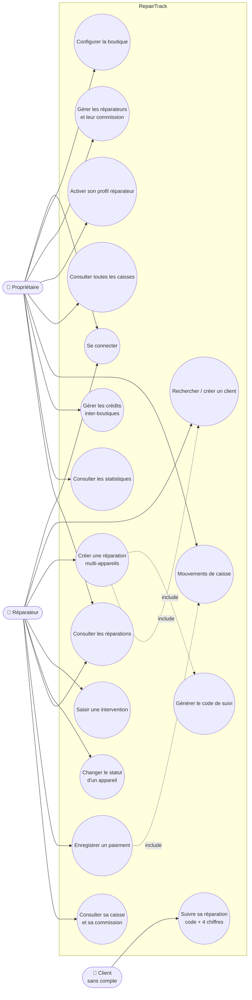

# Diagramme de cas d'utilisation — RepairTrack

> Les identifiants EF-xx renvoient à `docs/requirements.md`. Mermaid n'a pas de diagramme de cas d'utilisation natif : il est représenté par un graphe (acteurs à gauche, cas d'utilisation dans le système).

**Héritage d'acteur** : un propriétaire qui a activé son profil réparateur (EF-06) peut réaliser tous les cas d'utilisation du réparateur, avec le même compte.

| Cas | Acteur | Jalon |
|-----|--------|-------|
| Se connecter, configurer la boutique, gérer les réparateurs, profil réparateur | P, R | J1 ✅ |
| Client, réparation, intervention, statut, suivi client | R, C | J2 ✅ |
| Paiement, commission, caisses | R, P | J3 ✅ |
| Crédits, statistiques | P | J4 ✅ |
